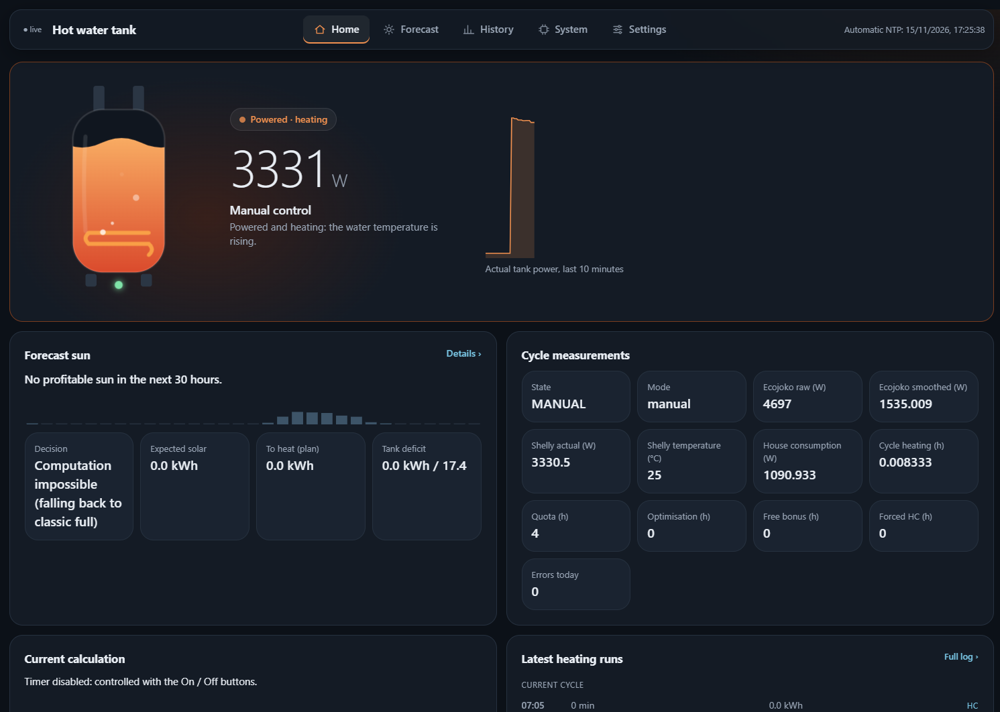

<p align="center">
  
</p>

**🌐 Language: English | [Français](./ballon_eau_chaude_fr/README.md)**

# Smart Water Heater (ESP32 + Ecojoko + Shelly/Ogemray)

> [!CAUTION]
> ## ⚠️ SAFETY WARNING – MAINS VOLTAGE (230 V) AND HIGH POWER
>
> This project controls an electric water heater: **230 V mains voltage and a load of several kilowatts** (typically 2 to 3 kW, i.e. 10 to 15 A or more). Mistakes can cause **electrocution, fire, or death**.
>
> - **Always switch off the circuit at the breaker and verify the absence of voltage** before touching any wiring, relay, or contactor.
> - **Any work on the 230 V side must be carried out by a qualified electrician**, or by someone who fully understands and is legally allowed to do this work in their country. If in doubt, do not do it.
> - Make sure the relay (Shelly / Ogemray) is **rated for the load** (current, continuous duty, heat dissipation) and that the **wire gauge, terminals and protections** (circuit breaker, 30 mA residual-current device) are correct.
> - **Keep the low-voltage electronics (ESP32, C3, buzzer, wiring) strictly separated from mains parts**, in a closed, insulated enclosure with no exposed live conductors.
> - **Do not remove or bypass the water heater's own safety devices** (thermostat, thermal safety cut-out, pressure relief valve). Software is never a substitute for hardware safety.
> - The firmware can fail (network outage, bug, crash). The relay may stay on or off unexpectedly: **never rely on this system as the only safety barrier.**
> - This project is provided **as is, without any warranty**. You build, install and use it **at your own risk and under your own responsibility**. The author cannot be held liable for any damage, injury or loss.

Electric water heater controller driven by an ESP32, which optimises when heating is triggered based on:
- **solar surplus** (retrieved from **Ecojoko**'s internal API),
- **off-peak / peak hours** (Linky tariff),
- and **tariff logic** (off-peak vs peak profitability, demand forecast).

The power relay (**Shelly 1PM Gen3**, since replaced by an **Ogemray 25A** module compatible with the Shelly API) switches the water heater on and off, while the original day/night contactor stays permanently forced in the closed position. A second ESP32-C3 acts as an external **watchdog**, independent from the main system, with an alarm buzzer.

> *The firmware and documentation are available in both languages: French in [`ballon_eau_chaude_fr/`](./ballon_eau_chaude_fr) (main version), English in [`hot_water_tank_EN/`](./hot_water_tank_EN).*

---

## Repository structure

```
arduino-hot-water-tank/
├── README.md                                   English README (repository home page)
├── doc/
│   └── capt_1.png                              Screenshot of the web interface
├── stl/                                        3D-printable enclosure parts
│   ├── 1_esp/
│   │   ├── 1_esp.STL                           Single-ESP enclosure (body)
│   │   └── 1_esp_top.STL                       Single-ESP enclosure (top)
│   └── 2_esp/
│       ├── 2_esp.STL                           Dual-ESP enclosure (body)
│       └── 2_esp_top.STL                       Dual-ESP enclosure (top)
│
├── ballon_eau_chaude_fr/                       French version (main)
│   ├── README.md                               French README
│   ├── esp32-ballon-ecojoko/                   Main firmware (ESP32)
│   │   ├── esp32-ballon-ecojoko.ino            Arduino program
│   │   ├── data/                               Files served by the ESP (LittleFS)
│   │   │   ├── index.html                      Web interface
│   │   │   └── index.html.gz                   Compressed (gzip) version served in production
│   │   └── tests/
│   │       └── index.test.mjs                  Tests for the interface's JS functions
│   ├── C3/
│   │   └── watchdog_c3/
│   │       └── watchdog_c3.ino                 Watchdog firmware (ESP32-C3)
│   ├── Guide_de_demarrage_Ballon_eau_chaude.docx/.pdf   Installation and setup
│   ├── Manuel_utilisation_Ballon.docx/.pdf              Daily use (interface, settings, glossary)
│   ├── Reference_technique_Ballon.docx/.pdf             Internals (Wi-Fi, Ecojoko/Shelly, diagnostics, troubleshooting)
│   └── montage_boitier_esp.docx/.pdf                    Physical enclosure assembly (single or dual ESP)
│
└── hot_water_tank_EN/                          English version
    ├── EN_esp32_ballon_ecojoko/
    │   ├── EN_esp32_ballon_ecojoko.ino
    │   └── data/
    │       ├── index.html
    │       └── index.html.gz
    ├── C3/
    │   └── watchdog_c3/
    │       └── watchdog_c3.ino
    ├── ESP_Enclosure_Assembly.docx/.pdf
    ├── Getting_Started_Guide_Hot_Water_Tank.docx/.pdf
    ├── Hot_Water_Tank_Technical_Reference.docx/.pdf
    └── Hot_Water_Tank_User_Manual.docx/.pdf
```

---

## Hardware

| Component | Role |
|---|---|
| ESP32 (classic dual-core) | Main board: control logic, web server, Ecojoko/Shelly API |
| ESP32-C3 (SuperMini) | Independent watchdog: monitors the main ESP and sounds a passive buzzer on prolonged failure |
| Shelly 1PM Gen3 *(replaced by an Ogemray 25A module, Shelly-compatible RPC API)* | Power relay that switches the water heater |
| Day/night contactor | Forced in permanent position ("EDF pilot" circuit cut); the relay now does all the work |
| Linky meter | Provides off-peak/peak schedules (read via NTP, no direct wiring) |
| Ecojoko | Provides real-time solar production (internal API, *Little Monkey* integration type) |
| Passive buzzer + on/off button | On the C3, for the alarm and its acknowledgement |

No dependency on Home Assistant or any cloud for basic operation: the ESP32 talks directly to Ecojoko (HTTPS) and to the relay (local HTTP).

---

## Software

- **Firmware**: Arduino C++ (`.ino`), **LittleFS** storage for the web interface and history
- **Web interface**: single page (`index.html`), served gzipped, with Home / History / Forecast / Settings / System tabs
- **Operating modes**: `auto` (quota, history), `manual`, `monitor`, **`full`** (recommended default: heats as soon as it is profitable during peak hours, and systematically during off-peak hours)
- **Forecast**: estimate of demand and solar production from learned history (no temperature sensor for now)
- **C3 watchdog**: GPIO link (heartbeat / alarm) + serial link to silence the alarm remotely

---

## Quick start

> [!WARNING]
> Read the safety warning at the top of this page first. Do the low-voltage part (flashing, Wi-Fi, web interface) with the relay **disconnected from mains**, and have the 230 V wiring done or checked by a qualified electrician.

1. Flash `esp32-ballon-ecojoko.ino` (or `EN_esp32_ballon_ecojoko.ino`) on the main ESP32, with the contents of `data/` in LittleFS.
2. Flash `watchdog_c3.ino` on the ESP32-C3.
3. Connect to the Wi-Fi access point broadcast by the ESP32 and enter your home Wi-Fi credentials.
4. In the web interface: enter the Ecojoko credentials, the relay IP, the tariffs and the off-peak/peak schedules.
5. Keep `full` mode (recommended default); the forecast can stay in observation mode until it is judged reliable.

For full details, see the **Getting Started Guide** (`Getting_Started_Guide_Hot_Water_Tank.docx` / `.pdf`).

---

## Documentation

| Document | Content |
|---|---|
| `ESP_Enclosure_Assembly` | Physical enclosure assembly (single ESP or dual ESP with buzzer/button) |
| `Getting_Started_Guide_Hot_Water_Tank` | Installation and setup (fallback network, program and page update, final check) |
| `Hot_Water_Tank_User_Manual` | Daily use: discovering the system, the interface, settings, glossary |
| `Hot_Water_Tank_Technical_Reference` | Internals: startup sequence, Wi-Fi, Ecojoko/Shelly exchanges, C3 watchdog role, diagnostics and troubleshooting |

*(French equivalents in `ballon_eau_chaude_fr/`: `montage_boitier_esp`, `Guide_de_demarrage_Ballon_eau_chaude`, `Manuel_utilisation_Ballon`, `Reference_technique_Ballon`.)*

---

## Current status

- Network resilience (Ecojoko/Shelly recovery after outage), automatic reboot if Ecojoko keeps failing
- Detailed history + monthly/yearly summary, export/import (CSV/JSON)
- "Forecast vs actual" tracking for solar and demand (shadow mode)
- Fully reworked web interface (dark theme, mobile/PC responsive)
- C3 watchdog operational (alarm, programmable quiet period, remote silencing)

Work in progress / ideas: possible switch to `ESPAsyncWebServer`, splitting `index.html` into HTML/CSS/JS, advanced thermal protection of the relay.

---

## Disclaimer

This project is shared for educational and personal use, **without any warranty**. It involves mains voltage and high power; you are solely responsible for its installation, compliance with local electrical regulations, and safe use.
