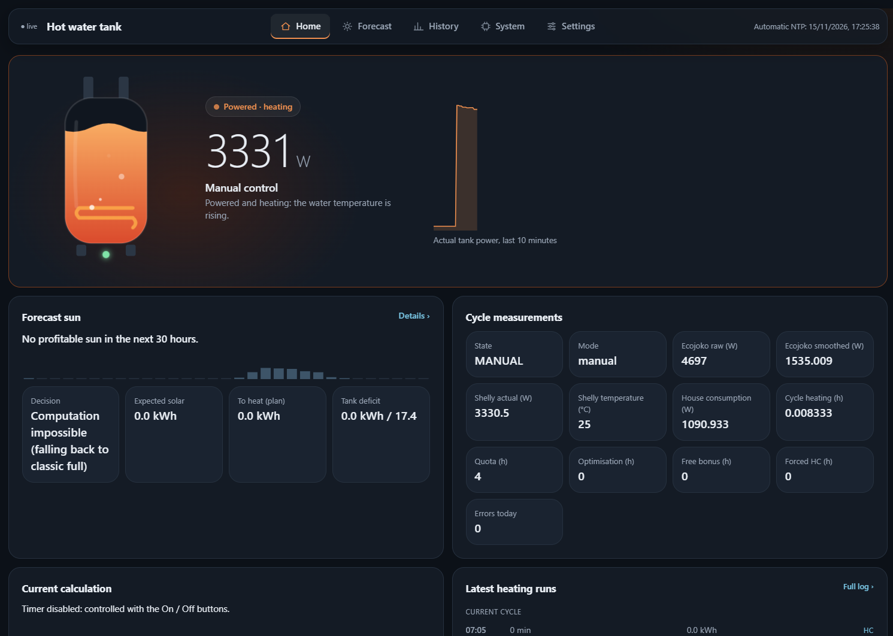

<p align="center">
  
</p>

**🌐 Langue : [English](../README.md) | Français**

# Ballon d'eau chaude intelligent (ESP32 + Ecojoko + Shelly/Ogemray)

> [!CAUTION]
> ## ⚠️ AVERTISSEMENT DE SÉCURITÉ – TENSION SECTEUR (230 V) ET FORTE PUISSANCE
>
> Ce projet pilote un chauffe-eau électrique : **tension secteur 230 V et charge de plusieurs kilowatts** (typiquement 2 à 3 kW, soit 10 à 15 A ou plus). Une erreur peut provoquer **électrocution, incendie ou mort**.
>
> - **Coupez toujours le circuit au disjoncteur et vérifiez l'absence de tension** avant de toucher au câblage, au relais ou au contacteur.
> - **Tout travail côté 230 V doit être réalisé par un électricien qualifié**, ou par une personne qui maîtrise parfaitement ces travaux et y est légalement autorisée dans son pays. Dans le doute, ne le faites pas.
> - Vérifiez que le relais (Shelly / Ogemray) est **dimensionné pour la charge** (courant, service continu, dissipation thermique) et que la **section des câbles, les bornes et les protections** (disjoncteur, différentiel 30 mA) sont adaptées.
> - **Séparez strictement l'électronique basse tension (ESP32, C3, buzzer, câblage) des parties secteur**, dans un boîtier fermé et isolé, sans aucun conducteur sous tension accessible.
> - **Ne retirez et ne contournez jamais les sécurités propres au chauffe-eau** (thermostat, sécurité thermique, soupape de sécurité). Un logiciel ne remplace jamais une sécurité matérielle.
> - Le programme peut tomber en panne (coupure réseau, bug, plantage). Le relais peut rester enclenché ou coupé de façon inattendue : **ne comptez jamais sur ce système comme unique barrière de sécurité.**
> - Ce projet est fourni **en l'état, sans aucune garantie**. Vous le construisez, l'installez et l'utilisez **à vos risques et sous votre seule responsabilité**. L'auteur ne peut être tenu responsable d'aucun dommage, blessure ou perte.

Contrôleur de chauffe-eau électrique piloté par un ESP32, qui optimise le déclenchement de la chauffe en fonction :
- du **surplus solaire** (remonté par l'API interne d'**Ecojoko**),
- des **heures creuses / heures pleines** (tarif Linky),
- et d'une **logique tarifaire** (rentabilité HC vs HP, prévision des besoins).

Le relais de puissance (**Shelly 1PM Gen3**, remplacé depuis par un module **Ogemray 25A** compatible API Shelly) coupe/active le chauffe-eau, le contacteur jour/nuit d'origine restant forcé en position permanente. Un second ESP32-C3 fait office de **chien de garde** externe (watchdog), indépendant du système principal, avec buzzer d'alarme.

> *English version of the firmware and documentation available in [`hot_water_tank_EN/`](../hot_water_tank_EN), and the English README at the [repository root](../README.md).*

---

## Structure du dépôt

```
arduino-hot-water-tank/
├── README.md                                   README anglais (page d'accueil du dépôt)
├── doc/
│   └── capt_1.png                              Capture d'écran de l'interface web
├── stl/                                        Pièces 3D du boîtier (impression)
│   ├── 1_esp/
│   │   ├── 1_esp.STL                           Boîtier mono-ESP (corps)
│   │   └── 1_esp_top.STL                       Boîtier mono-ESP (dessus)
│   └── 2_esp/
│       ├── 2_esp.STL                           Boîtier double ESP (corps)
│       └── 2_esp_top.STL                       Boîtier double ESP (dessus)
│
├── ballon_eau_chaude_fr/                       Version française (principale)
│   ├── README.md                               README français
│   ├── esp32-ballon-ecojoko/                   Firmware principal (ESP32)
│   │   ├── esp32-ballon-ecojoko.ino            Programme Arduino
│   │   ├── data/                               Fichiers servis par l'ESP (LittleFS)
│   │   │   ├── index.html                      Interface web
│   │   │   └── index.html.gz                   Version compressée (gzip) servie en prod
│   │   └── tests/
│   │       └── index.test.mjs                  Tests des fonctions JS de l'interface
│   ├── C3/
│   │   └── watchdog_c3/
│   │       └── watchdog_c3.ino                 Firmware du chien de garde (ESP32-C3)
│   ├── Guide_de_demarrage_Ballon_eau_chaude.docx/.pdf   Installation et mise en route
│   ├── Manuel_utilisation_Ballon.docx/.pdf              Utilisation au quotidien (interface, réglages, glossaire)
│   ├── Reference_technique_Ballon.docx/.pdf             Fonctionnement interne (Wi-Fi, Ecojoko/Shelly, diagnostic, dépannage)
│   └── montage_boitier_esp.docx/.pdf                    Montage physique du boîtier (mono ou double ESP)
│
└── hot_water_tank_EN/                          English version
    ├── EN_esp32_ballon_ecojoko/
    │   ├── EN_esp32_ballon_ecojoko.ino
    │   └── data/
    │       ├── index.html
    │       └── index.html.gz
    ├── C3/
    │   └── watchdog_c3/
    │       └── watchdog_c3.ino
    ├── ESP_Enclosure_Assembly.docx/.pdf
    ├── Getting_Started_Guide_Hot_Water_Tank.docx/.pdf
    ├── Hot_Water_Tank_Technical_Reference.docx/.pdf
    └── Hot_Water_Tank_User_Manual.docx/.pdf
```

---

## Matériel

| Composant | Rôle |
|---|---|
| ESP32 (dual-core classique) | Carte principale : logique de pilotage, serveur web, API Ecojoko/Shelly |
| ESP32-C3 (SuperMini) | Chien de garde indépendant : surveille l'ESP principal, sonne un buzzer passif en cas de panne prolongée |
| Shelly 1PM Gen3 *(remplacé par un module Ogemray 25A, API RPC compatible Shelly)* | Relais de puissance qui commande le chauffe-eau |
| Contacteur jour/nuit | Forcé en position permanente (circuit « Pilote EDF » coupé) ; le relais fait désormais tout le travail |
| Compteur Linky | Fournit les horaires HC/HP (lus via NTP, pas de câblage direct) |
| Ecojoko | Fournit la production solaire en temps réel (API interne, type intégration *Little Monkey*) |
| Buzzer passif + bouton on/off | Sur le C3, pour l'alarme et son acquittement |

Aucune dépendance à Home Assistant ou à un cloud pour le fonctionnement de base : l'ESP32 parle directement à Ecojoko (HTTPS) et au relais (HTTP local).

---

## Logiciel

- **Firmware** : Arduino C++ (`.ino`), stockage **LittleFS** pour l'interface web et l'historique
- **Interface web** : page unique (`index.html`), servie en gzip, avec onglets Accueil / Historique / Prévision / Réglages / Système
- **Modes de fonctionnement** : `auto` (quota, historique), `manual`, `monitor`, **`full`** (mode recommandé par défaut : chauffe dès que c'est rentable en HP, et systématiquement pendant les heures creuses)
- **Prévision** : estimation du besoin et de la production solaire à partir de l'historique appris (sans sonde de température pour l'instant)
- **Chien de garde C3** : liaison GPIO (battement de cœur / alarme) + liaison série pour la mise en silence à distance de l'alarme

---

## Démarrage rapide

> [!WARNING]
> Lisez d'abord l'avertissement de sécurité en haut de cette page. Faites la partie basse tension (flashage, Wi-Fi, interface web) avec le relais **déconnecté du secteur**, et faites réaliser ou vérifier le câblage 230 V par un électricien qualifié.

1. Flasher `esp32-ballon-ecojoko.ino` (ou `EN_esp32_ballon_ecojoko.ino`) sur l'ESP32 principal, avec le contenu de `data/` en LittleFS.
2. Flasher `watchdog_c3.ino` sur l'ESP32-C3.
3. Se connecter au point d'accès Wi-Fi émis par l'ESP32 et y renseigner les identifiants du Wi-Fi de la maison.
4. Dans l'interface web : renseigner les identifiants Ecojoko, l'IP du relais, les tarifs et les horaires HC/HP.
5. Laisser le mode `full` (mode par défaut conseillé) ; la prévision peut rester en observation tant qu'elle n'est pas jugée concluante.

Pour le détail complet, voir le **Guide de démarrage** (`Guide_de_demarrage_Ballon_eau_chaude.docx` / `.pdf`).

---

## Documentation

| Document | Contenu |
|---|---|
| `montage_boitier_esp` | Montage physique du boîtier (mono-ESP ou double ESP avec buzzer/bouton) |
| `Guide_de_demarrage_Ballon_eau_chaude` | Installation et mise en route (réseau de secours, mise à jour du programme et de la page, vérification finale) |
| `Manuel_utilisation_Ballon` | Utilisation au quotidien : découvrir le système, l'interface, les réglages, glossaire |
| `Reference_technique_Ballon` | Fonctionnement interne : séquence de démarrage, Wi-Fi, échanges Ecojoko/Shelly, rôle du chien de garde C3, diagnostic et dépannage |

*(Versions anglaises équivalentes dans `hot_water_tank_EN/` : `ESP_Enclosure_Assembly`, `Getting_Started_Guide_Hot_Water_Tank`, `Hot_Water_Tank_User_Manual`, `Hot_Water_Tank_Technical_Reference`.)*

---

## État actuel

- Résilience réseau (reprise Ecojoko/Shelly après coupure), redémarrage auto si Ecojoko reste en échec
- Historique détaillé + récap mensuel/annuel, export/import (CSV/JSON)
- Suivi « prévu vs réel » du solaire et du besoin (mode shadow)
- Interface web entièrement remaniée (thème sombre, responsive mobile/PC)
- Chien de garde C3 opérationnel (alarme, plage de silence programmable, mise en silence à distance)

Travaux en cours / pistes : passage éventuel à `ESPAsyncWebServer`, séparation de `index.html` en HTML/CSS/JS, protection thermique avancée du relais.

---

## Avertissement

Ce projet est partagé à titre éducatif et personnel, **sans aucune garantie**. Il implique une tension secteur et une forte puissance ; vous êtes seul responsable de son installation, du respect de la réglementation électrique locale et de son utilisation en sécurité.
